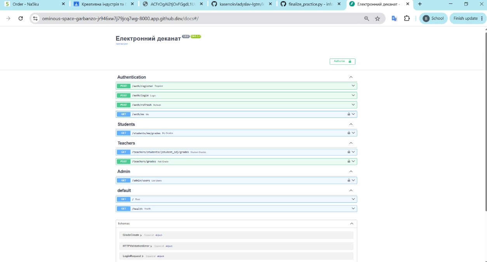
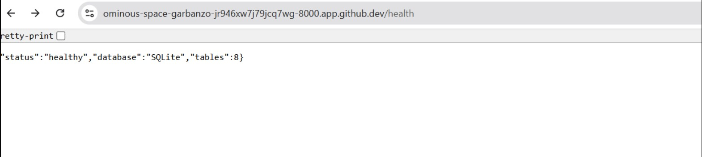
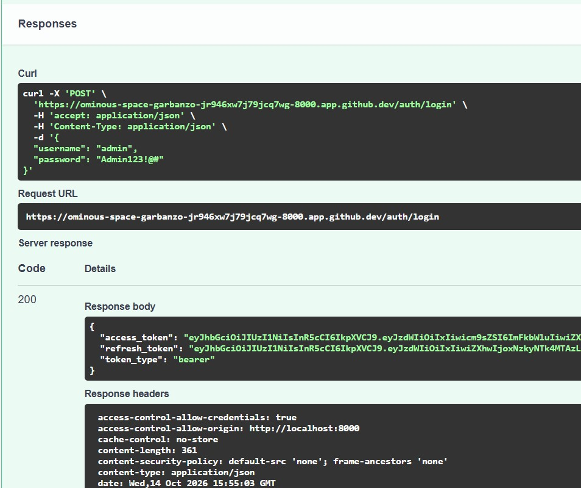
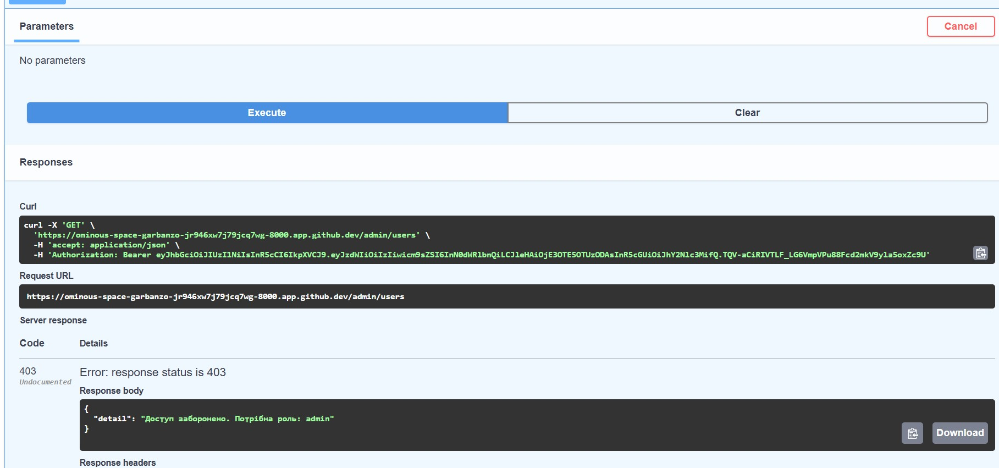
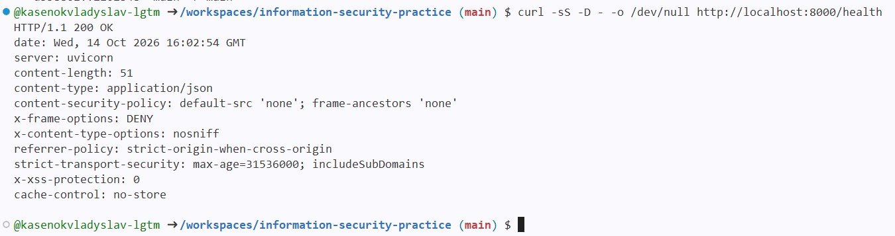

# ЗПР №1 — Захищений REST API «Електронний деканат»

**Дисципліна:** Безпека інформаційних систем  
**Студент:** Касенок Владислав
**Група:** 233 заочна (он)

## Опис

Навчальний REST API на **FastAPI, SQLite, SQLAlchemy, Alembic, Docker Compose**.
Реалізовано RBAC (admin / teacher / student), bcrypt, JWT access/refresh, Pydantic-валідацію,
CORS allow-list, Security Headers, Rate Limiting та захист від Stored XSS.

## Запуск

```bash
git clone https://github.com/kasenokvladyslav-lgtm/information-security-practice.git
cd information-security-practice
cp .env.example .env
sed -i "s/replace-me-with-64-hex-chars/$(openssl rand -hex 32)/" .env
docker compose up -d --build
docker compose exec api alembic upgrade head
docker compose exec api python -m app.seed
```

API: http://localhost:8000  
Swagger UI: http://localhost:8000/docs

> Паролі `Admin123!@#`, `Teacher123!`, `Student123!` призначені **лише для локального демонстраційного середовища**.
> Не публікуйте `.env`, SQLite-базу даних, справжні токени чи секрети.

## Ендпоінти

| Метод | Маршрут | Хто має доступ |
|---|---|---|
| GET | `/` | public |
| GET | `/health` | public |
| POST | `/auth/register` | public (новий студент) |
| POST | `/auth/login` | public |
| POST | `/auth/refresh` | refresh token |
| GET | `/auth/me` | access token |
| GET | `/students/me/grades` | student |
| GET | `/teachers/students/{student_id}/grades` | teacher, admin |
| POST | `/teachers/grades` | teacher, admin |
| GET | `/admin/users` | admin |

## RBAC-матриця

| Дозвіл | admin | teacher | student |
|---|:---:|:---:|:---:|
| read_grades | ✅ | ✅ | ✅ |
| edit_grades | ✅ | ✅ | ❌ |
| read_schedule | ✅ | ✅ | ✅ |
| manage_users | ✅ | ❌ | ❌ |
| manage_groups | ✅ | ❌ | ❌ |
| manage_subjects | ✅ | ❌ | ❌ |
| view_reports | ✅ | ✅ | ❌ |

## STRIDE — модель загроз

| Загроза | Приклад | Захист |
|---|---|---|
| Spoofing | Видавання себе за іншого | bcrypt + JWT з перевіркою підпису |
| Tampering | Зміна оцінок без повноважень | RBAC, роль із БД, валідація |
| Repudiation | Заперечення виставленої оцінки | `grades.assigned_by` |
| Information Disclosure | Доступ до чужих даних | Персональна фільтрація оцінок, 401/403 |
| Denial of Service | Автоматизований перебір логінів | Ліміт 5 запитів/хв |
| Elevation of Privilege | Студент викликає `/admin/users` | `require_role('admin')`, 403 |
| Stored XSS | HTML в коментарях | `bleach.clean(..., strip=True)`, CSP |

## Фінальна перевірка — 20 сценаріїв


| № | Сценарій | Очікувано | Фактично |
|---|---|---|---|
| 1 | Health | 200 | 200 ✅ |
| 2 | Реєстрація | 201 | 201 ✅ |
| 3 | Дублікат username | 409 | 409 ✅ |
| 4 | Слабкий пароль | 422 | 422 ✅ |
| 5 | XSS в імені | 422 | 422 ✅ |
| 6 | Логін admin | 200 | 200 ✅ |
| 7 | Невірний пароль | 401 | 401 ✅ |
| 8 | Без токена | 401 | 401 ✅ |
| 9 | Підроблений токен | 401 | 401 ✅ |
| 10 | Refresh замість access | 401 | 401 ✅ |
| 11 | Оновлення токенів | 200 | 200 ✅ |
| 12 | Свої оцінки | 200 | 200 ✅ |
| 13 | Студент → admin | 403 | 403 ✅ |
| 14 | Викладач → admin | 403 | 403 ✅ |
| 15 | Адмін → admin | 200 | 200 ✅ |
| 16 | Оцінка поза діапазоном | 422 | 422 ✅ |
| 17 | Stored XSS у коментарі | 201 | 201 + очищено ✅ |
| 18 | Security Headers | наявні | наявні ✅ |
| 19 | CORS чужий домен | 400 | 400 ✅ |
| 20 | Rate Limiting | 429 | 429 ✅ |

## Скріншоти результатів роботи

### 1. Документація REST API — Swagger UI



### 2. Перевірка стану сервера та бази даних



### 3. Успішна автентифікація користувача



### 4. Розмежування прав доступу — HTTP 403



### 5. Захисні HTTP-заголовки



## Висновок

Реалізовано кілька незалежних рівнів захисту (Defense in Depth). Аутентифікація визначає,
хто надіслав запит (401 без дійсного access token), авторизація визначає,
що цьому користувачу дозволено (403 за відсутності ролі).

## ЗПР №2 — журнал подій безпеки

Реалізовано аудит подій за моделлю 5W: автентифікація, реєстрація, відповіді 401/403/429, зміна оцінок і перегляд журналу. Події зберігаються у таблиці `audit_log` та виводяться у структурованому JSON-форматі без паролів і токенів. Передбачено виявлення серії невдалих входів та входу в неробочий час.

Адміністративні ендпоінти: `GET /admin/audit-log` (пошук, фільтрація, пагінація) та `GET /admin/security-stats` (статистика інцидентів). Доступ надається тільки ролі `admin`.
